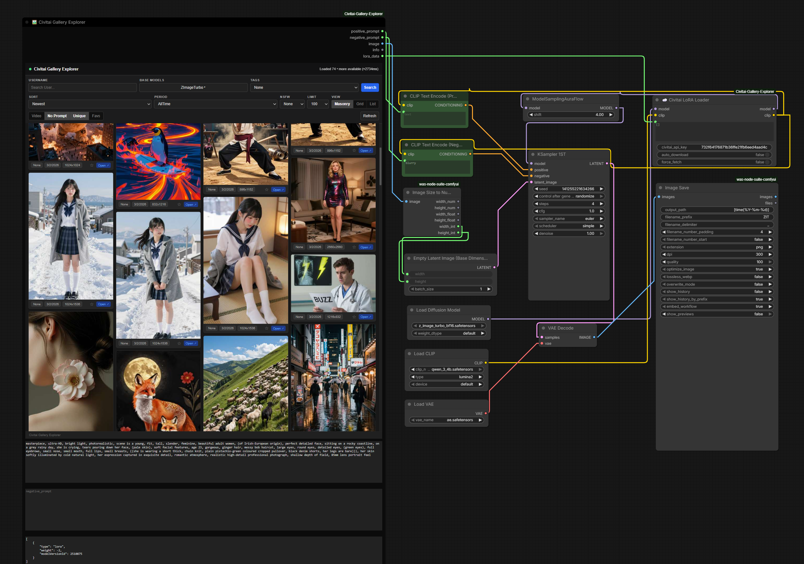

# CivitAI Gallery Explorer for ComfyUI

[](https://github.com/fabwaseem/ComfyUI-Civitai-Gallery-Explorer/actions/workflows/ci.yml)
[](https://github.com/fabwaseem/ComfyUI-Civitai-Gallery-Explorer/stargazers)
[](LICENSE)
[](https://registry.comfy.org/nodes/civitai-gallery-explorer)
[](https://github.com/astral-sh/ruff)

Browse the Civitai image gallery inside a ComfyUI node. Filter and scroll through posts, save favorites on disk, and send the selected positive prompt, negative prompt, preview image, and LoRA metadata into the rest of the graph.

The pack is published on the [Comfy Registry](https://registry.comfy.org/nodes/civitai-gallery-explorer) as `civitai-gallery-explorer` (publisher `@fabwaseem`, about 1.4K downloads). The [GitHub repository](https://github.com/fabwaseem/ComfyUI-Civitai-Gallery-Explorer) currently has 3 stars.



## Features

- Infinite-scroll gallery with masonry, grid, and list layouts
- Filters for username, base model, tag, sort, period, NSFW level, and page size
- Toggles for video-only results, posts that include a positive prompt, unique prompts, and favorites
- Click a card to fill `positive_prompt`, `negative_prompt`, and `lora_data`
- Image output downloads the selected preview when that output is connected
- Local favorites stored in `civitai_favorites.json` next to the node
- **Civitai LoRA Loader** resolves LoRA names, version ids, and hashes, then applies them with ComfyUI's LoRA loader
- Optional auto-download of missing LoRAs, with resume, retries, and TLS verification
- Optional Civitai API key for downloads that require authentication

## Installation

### ComfyUI Manager

1. Open **ComfyUI Manager**.
2. Choose **Install Custom Nodes**.
3. Search for `CivitAI Gallery Explorer`.
4. Install it and restart ComfyUI.

From a shell with the ComfyUI CLI:

```bash
comfy node install civitai-gallery-explorer
```

### Git

```bash
cd ComfyUI/custom_nodes
git clone https://github.com/fabwaseem/ComfyUI-Civitai-Gallery-Explorer.git
cd ComfyUI-Civitai-Gallery-Explorer
pip install -r requirements.txt
```

Restart ComfyUI after installing.

## Usage

1. Add a node from `💡fabwaseem/Civitai`:
   - `🖼️ Civitai Gallery Explorer`
   - `☁️ Civitai LoRA Loader`
2. Search and filter the gallery, then click a card.
3. Connect `positive_prompt` and `negative_prompt` to your text encoders.
4. Connect `image` when you want the selected preview as an image input. The preview is fetched only when that output is linked.
5. Connect `lora_data` to **Civitai LoRA Loader**.
6. On the loader, leave **Auto Download** enabled to fetch a missing file into the LoRA folder. **Force Fetch** rechecks a file that is already on disk. An API key is optional and is sent only as a Civitai download token.

An example graph is in [assets/example-workflow.json](assets/example-workflow.json). The same file is also available to ComfyUI as [example_workflows/civitai_gallery_explorer.json](example_workflows/civitai_gallery_explorer.json).

## Screenshot

The gallery UI shown above is stored at [docs/screenshots/preview.png](docs/screenshots/preview.png).

## Development

```bash
pip install ruff pytest numpy pillow aiohttp tqdm typing_extensions
ruff check .
pytest -q tests
node --check js/Civitai_Gallery_Explorer.js
```

## License

MIT. See [LICENSE](LICENSE).

Developed by Waseem Anjum (fabwaseem).
